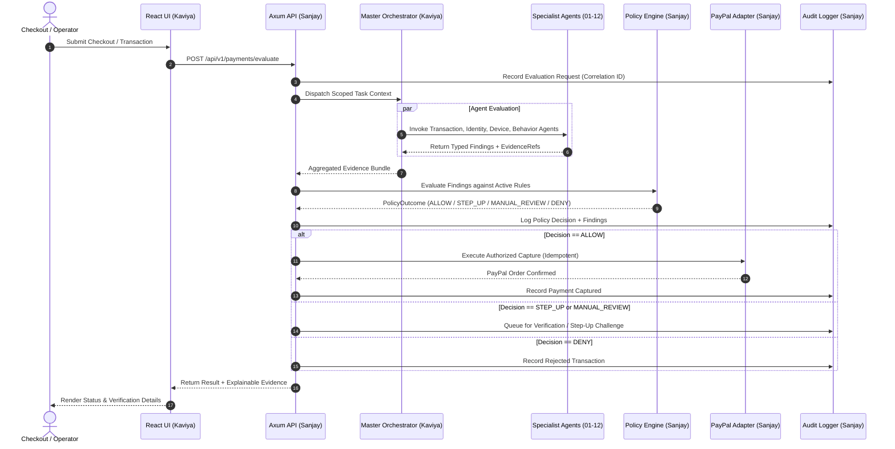

# System Architecture & Technical Design

**Document ID:** `ARCH-001`  
**Version:** `1.0.0`  
**Lead Architect:** Sanjay  
**Reviewer:** Kaviya  

---

## 1. High-Level Topology

```
┌─────────────────────────────────────────────────────────────────┐
│                      OPERATOR & CUSTOMER UI                     │
│               React 19 + TypeScript + TailwindCSS               │
│                        👤 Owner: Kaviya                         │
└────────────────────────────────┬────────────────────────────────┘
                                 │ HTTPS / TLS 1.3
                                 ▼
┌─────────────────────────────────────────────────────────────────┐
│                     RUST API GATEWAY (Axum)                     │
│        Auth · Tenant Isolation · Trace Context · Rate Limit     │
│                        👤 Owner: Sanjay                         │
├─────────────────┬───────────────────────────────┬───────────────┤
│                 │                               │               │
│                 ▼                               ▼               │
│   ┌───────────────────────────┐   ┌──────────────────────────┐  │
│   │  Agent Orchestrator (00)  │   │  Policy Engine (Rust)    │  │
│   │      👤 Owner: Kaviya     │   │     👤 Owner: Sanjay     │  │
│   │                           │   │                          │  │
│   │  ┌─────────────────────┐  │   │  Deterministic Evaluator │  │
│   │  │ 13 Specialist       │  │   │  - ALLOW                 │  │
│   │  │ Advisory Agents     │──┼───▶  - DENY                  │  │
│   │  │ (00 .. 12)          │  │   │  - STEP_UP               │  │
│   │  └─────────────────────┘  │   │  - MANUAL_REVIEW         │  │
│   └───────────────────────────┘   └─────────────┬────────────┘  │
│                                                 │               │
│                                                 ▼               │
│                                   ┌──────────────────────────┐  │
│                                   │ PayPal Gateway Adapter   │  │
│                                   │     👤 Owner: Sanjay     │  │
│                                   │  Sandbox Orders/Capture  │  │
│                                   │  Signature Verification  │  │
│                                   │  Idempotent Webhooks     │  │
│                                   └─────────────┬────────────┘  │
│                                                 │               │
├─────────────────────────────────────────────────┼───────────────┤
│                                                 │               │
│                                                 ▼               │
│        PostgreSQL 16 (SQLx) ────────▶ Audit & Telemetry         │
│     Tenants · Payments · Findings          👤 Owner: Sanjay     │
└─────────────────────────────────────────────────────────────────┘
```

---

## 2. Trust Boundaries & Isolation

1. **Layer 1: Client / Browser (Untrusted):**
   - The React client provides UI interactions, forms, and visualization.
   - It cannot authorize financial transactions or dictate risk scores.
   - All tenant identifiers provided by the browser are strictly validated against authenticated session tokens.

2. **Layer 2: API & Gateway Boundary:**
   - Axum server handles authentication via cryptographically signed tokens.
   - Strict input validation using serde typed structs before any payload reaches core logic.
   - Enforces per-tenant resource limits and rate limits.

3. **Layer 3: Agent Runtime Sandbox:**
   - Agents operate under narrow, read-only permissions for transaction data.
   - Resource execution limits: bounded memory and strict timeouts (e.g., 500ms).
   - Agent outputs are treated as untrusted hypotheses until verified against schema and evidence requirements.

4. **Layer 4: Deterministic Policy Engine:**
   - Pure, deterministic Rust implementation.
   - Evaluates aggregated agent evidence against versioned policy rules.
   - No LLM may override or modify policy outcomes.

5. **Layer 5: Payment Adapter Boundary:**
   - Only `payment-paypal` service holds PayPal client credentials.
   - All financial mutations (authorize, capture, refund) require:
     1. Prior policy engine `ALLOW` status
     2. Valid idempotency key
     3. Active operator/system permission

6. **Layer 6: Audit & Data Persistence:**
   - Append-only audit logs for security and financial actions.
   - Database queries scoped strictly by `tenant_id` at the SQL query parameter level.

---

## 3. Core Transaction & Decision Lifecycle



---

## 4. Key Technology Choices

- **Rust (Tokio, Axum, SQLx):** Memory safety, high throughput, zero garbage-collection latency spikes for financial decision paths.
- **React 19 + TypeScript:** Type-safe operator dashboard and real-time visualization of agent evidence.
- **PostgreSQL:** ACID-compliant relational data store for ledgers, tenant configurations, and auditable events.
- **PayPal Sandbox APIs:** Industry-standard payment gateway integration with idempotent webhook processing.

